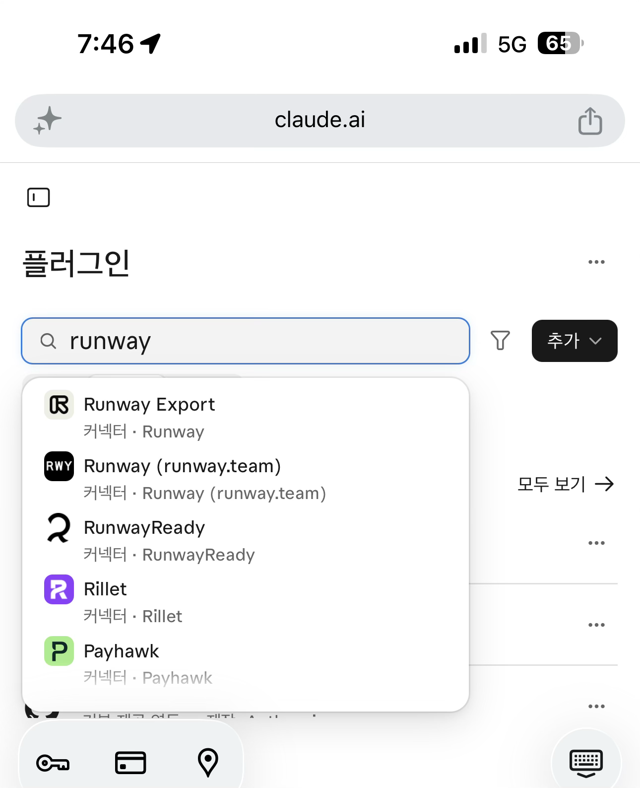

# Runway MCP 커스텀 커넥터 연결 기록

- 기간: 2026-11-17 ~ 2026-11-18
- 대상 MCP 서버: `https://mcp.runwayml.com/mcp`
- 첨부 파일: [runway_search_screenshot.png](./runway_search_screenshot.png)

---

## 1. 요청: 커스텀 커넥터 연결

**사용자**
> https://mcp.runwayml.com/mcp
> 내 커스텀커넥트에 연걸해줘

**Claude**

커스텀 커넥터는 제가 이 세션에서 대신 추가할 수 없어서 직접 등록하셔야 해요. 1분이면 됩니다.

**등록 방법**
1. https://claude.ai/customize/connectors 를 엽니다.
2. **커스텀 커넥터 추가(Add custom connector)**를 누릅니다.
3. 이름은 `Runway` 등 원하는 것으로 적습니다. URL은 `https://mcp.runwayml.com/mcp` 를 넣습니다.
4. **추가**를 누르면 Runway 로그인(OAuth) 창이 뜹니다. 로그인한 뒤 권한을 허용하면 됩니다.
5. 커넥터 목록은 세션이 시작될 때만 불러옵니다. 그래서 등록한 뒤에는 **새 세션을 열어야** Runway 도구를 쓸 수 있습니다.

참고로 지금 세션에 있는 Runway 관련 커넥터는 `Runway Export`(모션 가져오기) 하나뿐입니다. 위 MCP 서버와는 다른 커넥터예요.

---

## 2. 질문: 검색 결과 중 어느 것인가

**사용자** (스크린샷 첨부: claude.ai 플러그인 화면에서 `runway` 검색)
> 이준에 어떤거야

스크린샷에 보인 검색 결과:
- Runway Export — 커넥터 · Runway
- Runway (runway.team) — 커넥터 · Runway (runway.team)
- RunwayReady — 커넥터 · RunwayReady
- Rillet — 커넥터 · Rillet
- Payhawk — 커넥터 · Payhawk

**Claude**

`mcp.runwayml.com/mcp`와 똑같은 커넥터는 이 목록에 없어요.

| 목록 항목 | 정체 | 이번 것과 같나? |
|---|---|---|
| **Runway Export** | Runway(영상 AI 회사)가 만든 커넥터. 이미 연결돼 있고, 모션을 Runway로 보내는 기능만 있습니다 | 아님 (다른 커넥터) |
| Runway (runway.team) | 모바일 앱 출시를 관리하는 다른 회사 서비스 | 아님 |
| RunwayReady | 관계없는 서비스 | 아님 |

목록에서 고르지 말고 아래처럼 직접 추가하세요.

1. 오른쪽 위 검정 **추가 ⌄** 버튼을 누르고 **커스텀 커넥터 추가**를 고릅니다.
2. 이름은 `Runway`, URL은 `https://mcp.runwayml.com/mcp` 를 넣습니다.
3. Runway 로그인 창이 뜨면 로그인하고 권한을 허용합니다.
4. 커넥터는 세션을 시작할 때만 불러와요. 그래서 등록이 끝나면 **새 세션**을 열어야 쓸 수 있습니다.

---

## 3. 요청: 전체 기록과 파일을 md로 저장

**사용자**
> 전체 기록과 파일을 md 파일로 저장

**Claude**: 이 문서와 첨부 스크린샷을 `docs/runway_connector/`에 저장했습니다.

---

## 현재 상태 (2026-11-18)

- `runway` 커넥터가 이 세션에 **연결됨**. 영상·이미지·음악·음성 생성, 업스케일, 배경 제거, 워크플로 등의 도구를 쓸 수 있습니다
  (예: `generate_video`, `generate_image`, `generate_music`, `generate_speech`, `upscale_video`, `remove_video_background`, `run_workflow`).
- 기존 `Runway Export` 커넥터는 연결에 실패했고(404), 그 기능(`import-claude-motion-from-url`)은 새 `runway` 커넥터에 들어 있습니다.
