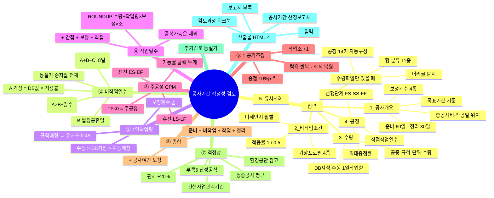

# 공사기간 적정성 검토 — 마인드맵 (Claude 직접 수행판)

## 1. 한눈에 보는 구조 (Mermaid 마인드맵)

## 2. 텍스트 트리 (각 가지의 내용)

- **공사기간 적정성 검토** (중심)
  - **입력** (`계산절차.md` §0, §10)
    - 1_공사개요: 사업·위치·총공사비·착공일·준비/정리기간·관측지점·보정계수·목표기간 기준·허용범위
    - 2_비작업조건: 프로필(옥외·구조물·옥내·연속작업)별 조건번호:적용률, 미세먼지·사용자정의 월별
    - 3_수량 / 4_공정 / 5_유사사례
    - 수량파일만 있을 때: 시트별 머리글 탐지 → 행 분류(§11 규칙) → 공정ID(`코드-키`) 배정 → 템플릿으로 공정·선행 자동구성
  - **② 비작업일수** (§1) — 월×프로필: A=Σround(값×적용률,2)→round(,1), B=공휴일, C=round_half_up(A×B÷일수), 적용=max(A+B−C,8)→정수반올림
  - **③ 1일작업량** (§3) — 수동입력 > DB지정(번호·이름·유사도 0.6) > 자동매칭(규칙→단위일치 Dice≥0.45), 보정계수=현장×규모×지질×기상×개별
  - **④ 작업일수** (§3-3) — ROUNDUP(수량÷(1일작업량×보정×작업조)), 공정 W=Σ(작업일수+간접+보정)+직접
  - **⑤ 주공정 CPM** (§2, §4) — 공정별 가동률 달력, finish/start_for_finish, 전진(FS/SS/FF)·후진, TF=LS−ES, 주공정=TF≤0
  - **⑤-1 공기조정** (§5) — 목표 초과 시: 작업조 증원 / 선행 중첩(10%p) 후보를 시험 계산해 최대 단축 채택, 최대 300회·연속 6회 무효 시 종료·최적 복원
  - **⑥ 종합** (§6) — 총일수=end+1, 준공일=착공+(총일수−1), 구성=준비+비작업+작업+정리
  - **⑦ 적정성** (§7) — B=Y+준비+정리(부록5), 동종공사 평균(+가산), 건설사업관리기간·환경공단은 참고, 편차 ±20%
  - **추가검토** (§9) — 동절기(12·1·2월) 중지를 켜서 재계산
  - **산출물** (`산출물작성.md`) — HTML 4개, A4 세로, 본문 편집·저장·인쇄
  - **데이터·기준** — `data/holidays.json`·`weather_db.json`·`productivity_db.json`, `기준값.md`

## 3. 원본 Python → 이 스킬 문서 대응

| 원본 모듈 | 하던 일 | 지금은 어디에 |
|---|---|---|
| `refdata.py` + `data/*.json` | 기준 상수·DB | `기준값.md`, `data/` |
| `project.py` | 입력서식 5시트 읽기·쓰기 | `계산절차.md` §0, `04_입력.html` |
| `nonwork.py` | ② 비작업일수 | `계산절차.md` §1 |
| `calendar_cap.py` | 가동률 달력 | `계산절차.md` §2 |
| `workdays.py` | ③④ 1일작업량 매칭·작업일수 | `계산절차.md` §3, `기준값.md` §3·§10 |
| `schedule.py` | ⑤ CPM | `계산절차.md` §4 |
| `compress.py` | ⑤-1 공기조정 | `계산절차.md` §5 |
| `adequacy.py` | ⑦ 적정성 | `계산절차.md` §7 |
| `summary.py` | 월별표·공정률·집계 | `계산절차.md` §8 |
| `pipeline.py` | ①→⑦ 순서·작업경과 | `construction-period-reviewer.md` 2단계 |
| `qtyparse.py` + `wizard.py` | 수량파일→입력서식 | `계산절차.md` §10, `기준값.md` §11·§12 |
| `report.py`·`appendix.py`·`workbook.py`·`gantt.py`·`network.py`·`hwpxbuild.py`·`xlsxbuild.py`·`docbuild.py` | 보고서·부록·워크북·공정표 문서 생성 | `산출물작성.md` + `html_template.html` |
| `service.py`·`web/`·`__main__.py`·`combine.py` | 웹 화면·명령줄·복합공사 | 대화로 대체(복합공사는 `construction-period-reviewer.md` 0-1) |
